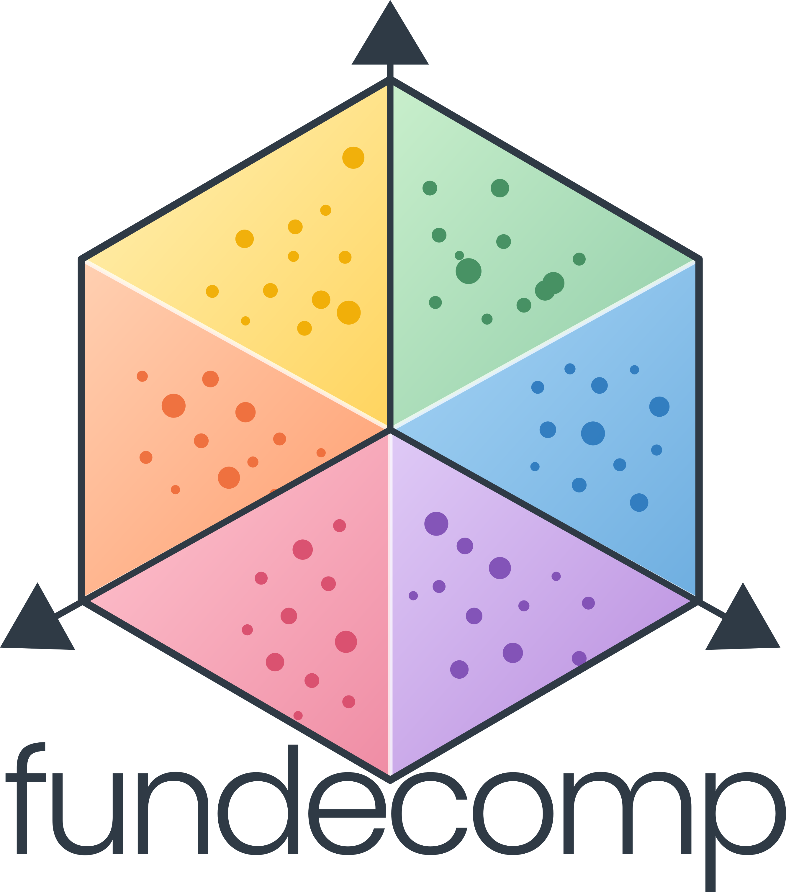

# fundecomp 

`fundecomp` decomposes changes in functional metrics between observed community states into contributions from ecological components. It extends the Measurement of Biodiversity framework and reports mathematical allocations of an observed contrast, not causal effects.

## Decomposition framework

The implemented components are total abundance (`N`), the species-abundance distribution (`SAD`), sample-level spatial allocation (`aggregation`), the species-trait distribution (`STD`), Trait-Abundance association (`TA`) and, when individual trait observations are supplied, intraspecific trait variation (`ITV`). Decompositions use observed reference and focal endpoints. Sequential paths and Shapley averaging are available; selected-component decompositions reconstruct their conditional contrast. See `?decompose_fmetric_change` and the package vignette for definitions and constraints.

## Capabilities

- Construct and validate temporal or other multi-state community inputs.
- Decompose functional metric changes, including community-weighted means and supported functional diversity metrics.
- Analyse time series, sampling effort and individual trait observations.
- Inspect component contributions, plot results, and validate reconstruction and margins.
- Generate fixed-margin aggregation nulls and break the trait-abundance link while preserving its margins.

## Installation

```r
install.packages("remotes")

remotes::install_github(
  "pgauzere/fundecomp",
  upgrade = "never",
  dependencies = TRUE,
  build_vignettes = TRUE
)

library(fundecomp)
vignette("fundecomp-tutorial", package = "fundecomp")
```

`remotes::install_github()` does not build package vignettes by default. The
`build_vignettes = TRUE` option above compiles the tutorial during installation;
`dependencies = TRUE` makes its vignette-building packages available.

## Minimal example

This example uses the small `census` and `species` teaching datasets included with the package.

```r
library(fundecomp)
data(census, package = "fundecomp")
data(species, package = "fundecomp")

community <- data.frame(
  series = "woodland", time = census$date, sample = census$site,
  species = census$species, abundance = census$n
)
input <- make_fundecomp_input(
  long = community,
  traits = species[, c("species", "size")],
  species_col = "species", count_data = TRUE
)
result <- decompose_fmetric_change(
  input,
  reference = list(series = "woodland", time = min(community$time)),
  focal = list(series = "woodland", time = max(community$time)),
  metric = "CWM", trait = "size", effort_unit = "full", seed = 42
)
get_fdelta_stats(result)
plot(result, type = "contributions")
```

## Main functions and documentation

Use `?decompose_fmetric_change` for two-state decompositions and `?decompose_fmetric_ts` for temporal series. Other entry points include `make_fundecomp_input`, `make_fundecomp_pool`, `extract_component_changes`, `plot_component_changes`, `validate_decomposition`, `null_aggregation` and `break_trait_abundance_link`. After installing with vignette building enabled, open the complete tutorial with `vignette("fundecomp-tutorial", package = "fundecomp")`. The source is available at [`vignettes/fundecomp-tutorial.Rmd`](https://github.com/pgauzere/fundecomp/blob/main/vignettes/fundecomp-tutorial.Rmd).

## Development status

This package is under active methodological development. Version 5.0.1 is made available for collaborators to install and test; interfaces and methods may change as the work develops.

## Problems and suggestions

Please report reproducible problems or suggestions in the [GitHub issue tracker](https://github.com/pgauzere/fundecomp/issues). Include your R version, package version, a minimal example and the complete error message.
